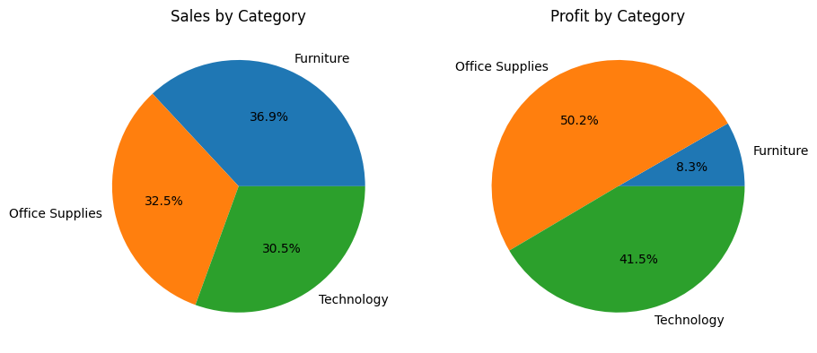
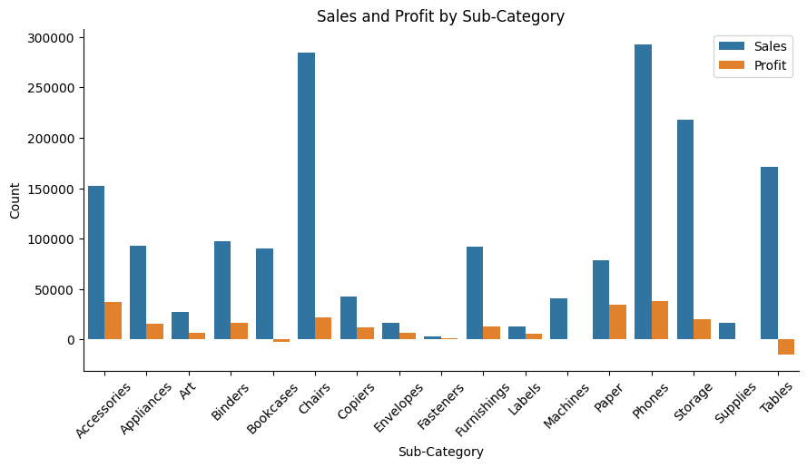
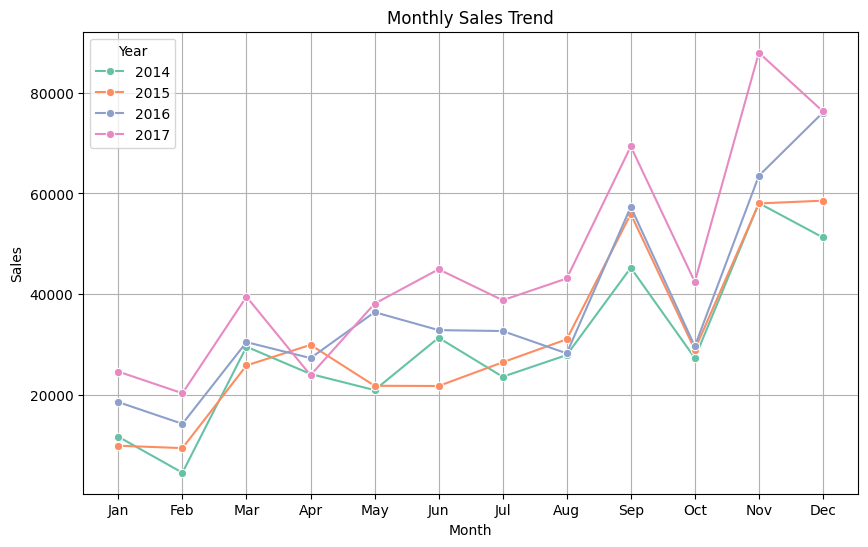
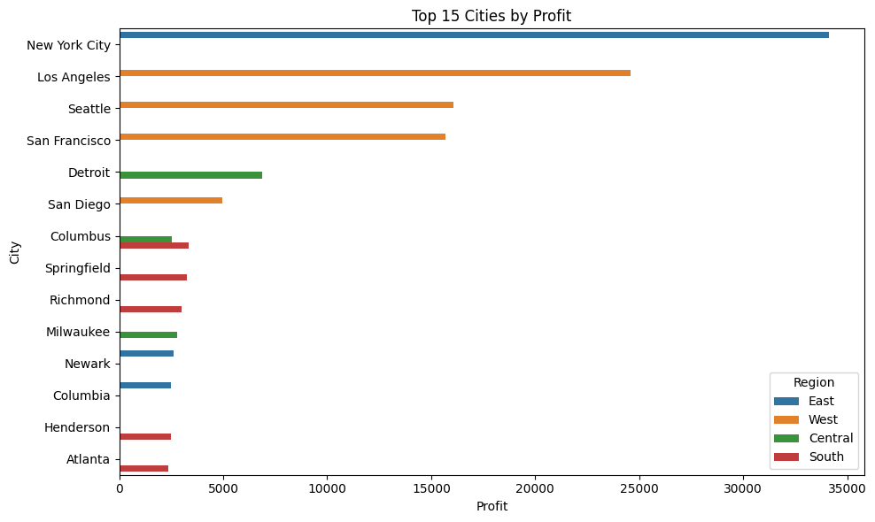
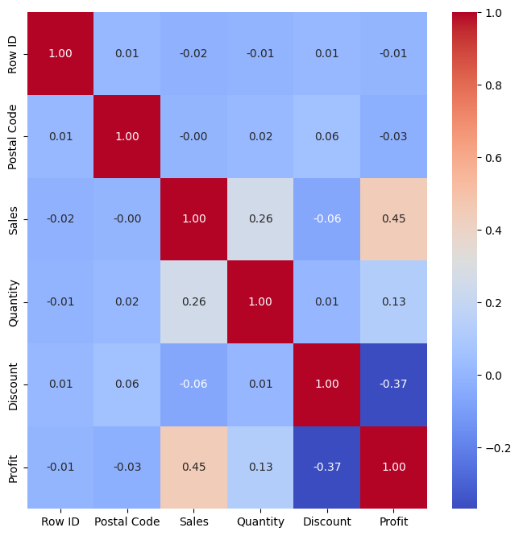

# Sales and Profit Analysis


Exploratory data analysis of **four years of US retail store orders (2014-2017)** to find out what drives profit: which categories, customer segments, regions and cities make money, and which lose it. Done in Python with pandas, Matplotlib and Seaborn.

## Business questions

- Which product categories and sub-categories are really profitable, not just high in sales?
- Which customer segments, regions and cities perform best or worst?
- How do sales and profit change through the year?
- What effect do discounts have on profit?

## Key findings

| Finding | Evidence |
|---|---|
| **High sales do not mean high profit** | Furniture is the biggest category by sales (**36.9%**) but delivers only **8.3%** of profit, a margin of just **2.7%** |
| **Office Supplies and Technology make the money** | Office Supplies **50.2%** and Technology **41.5%** of total profit |
| **Some sub-categories lose money** | **Tables** lose about **$15.4K** and **Bookcases** about **$2.1K**; Supplies is roughly break-even |
| **Best sub-categories** | **Phones** (about $37.9K profit), **Accessories** ($37.2K) and **Paper** ($34.0K) |
| **Deep discounts destroy profit** | Order lines with no discount average **+$46** profit; with a **20-40%** discount they average **-$65**, and over **40%** they average **-$54**. Discount and profit are negatively correlated (**-0.37**) |
| **Home Office is the best segment** | Margin of about **14%** vs about **12%** for Consumer and Corporate, even though Consumer has the most sales |
| **Two cities lead on sales and profit** | **New York City** (about $168K sales, $34.1K profit) and **Los Angeles** ($140K, $24.6K) |
| **Seattle beats San Francisco on profit** | Seattle earns **$16.1K** on $82K sales; San Francisco earns $15.7K on $92K |
| **Big sales, big losses** | **Philadelphia** is the 4th-largest city by sales ($87K) but has the largest loss (about **-$10.9K**) |
| **Strong seasonality** | Sales dip every **October** and peak in **November and December**; January and February are the weakest months |

## Charts

**Sales vs. profit share by category**



**Sales and profit by sub-category**



**Monthly sales trend by year**



**Top cities by profit**



**Correlation heatmap** (note the negative link between Discount and Profit)



## Recommendations

- **Cap discounts at around 20%.** Beyond that, orders lose money on average.
- **Review Tables and Bookcases**: pricing, supplier cost and discounting.
- **Fix Furniture margins** before pushing more Furniture sales.
- **Investigate Philadelphia** (and other large loss-making cities) for discounting or shipping-cost problems.
- **Plan inventory and marketing around the Nov-Dec peak** and the October dip.

## Dataset

US store orders, **2014 to 2017**, 21 columns including `Order Date`, `Ship Mode`, `Segment`, `Region`, `City`, `Category`, `Sub-Category`, `Sales`, `Quantity`, `Discount` and `Profit`.

The raw file `data/store_sales.csv` has **20,088 rows**, because every record appears twice and 200 rows contain missing values. The notebook cleans this first:

| Step | Rows |
|---|---|
| Raw file | 20,088 |
| After removing missing values and duplicates | 9,992 |
| After removing outliers (z-score above 3 on Sales and Profit) | 9,827 |

## Method

1. Load the data (encoding `ISO-8859-1`), drop missing values and duplicates, reset the index.
2. Convert dates to datetime and create year, month and weekday features.
3. Review summary statistics, then detect outliers with box plots and z-scores.
4. Explore sales and profit over time, by segment, category, sub-category, region and city.
5. Check relationships with a pair plot and a correlation heatmap.

### A note on outliers

Removing outliers with a z-score filter drops **165 order lines**, and those are often legitimate large orders. The conclusions about categories depend on it: **with** the outliers kept, **Technology** is the most profitable category (**50.8%** of profit) and Office Supplies is second (42.8%). The main messages (Furniture's weak margin, the cost of discounts, Home Office as the best segment) hold either way.

## Project structure

```
sales-profit-analysis/
├── data/
│   └── store_sales.csv                  # raw dataset
├── notebooks/
│   └── sales_profit_analysis.ipynb      # full analysis with charts
├── images/                              # charts used in this README
├── requirements.txt
└── README.md
```

## How to run

```bash
git clone https://github.com/MohanNellore/sales-profit-analysis.git
cd sales-profit-analysis
python -m venv venv
source venv/bin/activate          # Windows: venv\Scripts\activate
pip install -r requirements.txt
jupyter notebook notebooks/sales_profit_analysis.ipynb
```

Run all cells from top to bottom. The notebook reads the data from `../data/store_sales.csv`.

## Next steps

- Build a Power BI or Tableau dashboard for sales, profit and discount tracking.
- Forecast monthly sales to support inventory planning.
- Test a profit-prediction model that includes discount and sub-category.

## Author

**Mohan Nellore**: [GitHub](https://github.com/MohanNellore) | [Portfolio](https://mohannellore.github.io)
